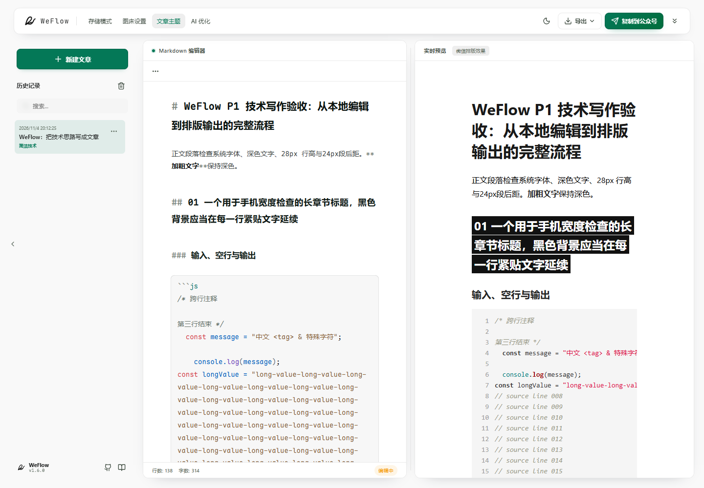
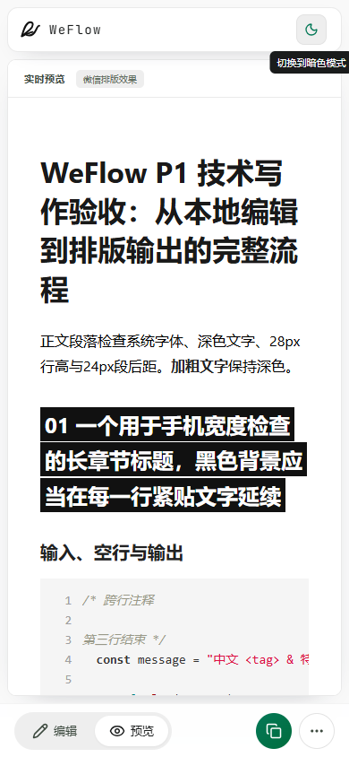

# P1 品牌与个人写作体验验收

日期：2026-11-04。范围为 WeFlow 品牌替换、独立「简洁技术」主题及原有写作输出流程，不扩展 AI 或 OSS 功能。

## 实现结果

- Web 页头、欢迎页、错误页、帮助入口、HTML 元数据与 PWA 显示 WeFlow。Electron 窗口、菜单、打包产品名称及图标同步更新，保留 `com.wemd.app` 与原 `WeMD` 用户数据目录。
- 单色图标以两条连续曲线表达笔尖与向前流动，SVG 为源，生成 favicon、16/32px 检查图、PWA 192/512px、maskable 及 Electron PNG/ICO/ICNS。已检查 32px 图标及页面实际小尺寸。
- 原上游官网、在线使用、下载与捐赠入口已移除；帮助与反馈转到个人仓库及项目文档。MIT LICENSE、原版权作者和第三方声明保留。
- 默认示例改为技术写作示例，图片随应用打包。Mac 栏保留原有 HTML 圆点，取消上游装饰图请求；其公众号后台保留情况仍需实测。
- Docker Compose 默认以当前源码构建 `weflow-web:local`，沿用 `WEMD_PORT` 的端口配置以兼容已有使用方式。
- 新主题 ID 为 `weflow-tech`，名称「简洁技术」。保留原 `default`，以及历史无元数据文件的默认解析规则和原回退顺序。
- 文件栏、共享新建操作和首次自动建文使用新主题，不继承前一篇的主题或自定义 CSS；重置到示例文章也使用新主题。历史记录和 Markdown 元数据仍按原保存主题恢复。
- `MarkdownParserOptions` 与主题元数据增加可选 `showCodeLineNumbers`，旧主题默认关闭，新主题开启；复制主题、浏览器镜像、工作区 JSON 和可视化主题 JSON 导入导出保留该字段。
- 预览、主题预览、公众号复制、长图共用行号解析。真实 DOM 行号与代码正文分离；跨行高亮 span 按行闭合、重开；保留中文、空行、缩进和转义字符，Mermaid 沿用原链路。
- 微信富文本含行号，纯文本另行还原原代码，不带行号并保留制表符。复制 HTML 仍提供原有语义结构。长图继续自动折行，并根据每条源代码行的实际高度调整对应行号高度。
- 内部 workspace 包名、存储键、`.wemd` 工作区格式、`#wemd` 及原主题 DOM 标识保持兼容。

## 文件分组

| 批次       | 主要文件                                                                                                                                                                                                                                                                                      |
| ---------- | --------------------------------------------------------------------------------------------------------------------------------------------------------------------------------------------------------------------------------------------------------------------------------------------- |
| 品牌       | `README.md`、`CONTRIBUTING.md`、`PRODUCT.md`、`DESIGN.md`、`docs/writing.md`；`apps/web/index.html`、`vite.config.ts`、`public/`；Header、Welcome、ErrorBoundary、SidebarFooter、SyntaxHelpPopover；`apps/electron` 显示配置、菜单及图标；`docker-compose.yml`；图标生成脚本                  |
| 主题与行为 | `packages/core/src/themes/weflow-tech.ts`、`codeLines.ts`、`MarkdownParser.ts`、`ThemeProcessor.ts`；`builtInThemes.ts`、`themeStore.ts`、`editorStore.ts`、`newArticleTheme.ts`、`HistoryManager.tsx`；MarkdownPreview、ThemeLivePreview、ThemePanelView；公众号复制与长图服务；对应回归测试 |
| 验收       | `docs/fixtures/p1-article.md`、本文件与 `docs/assets/p1-*.png`                                                                                                                                                                                                                                |

## 自动化检查

所有命令在仓库根目录运行，使用 Node.js 22 / pnpm 9。该机器沿用 P0 的 `.p0-local/corepack` 缓存和 `node_modules/.bin/pnpm.cmd` 入口。

| 命令                                             | 结果                                                       |
| ------------------------------------------------ | ---------------------------------------------------------- |
| `pnpm --filter @wemd/core test:ci`               | 11 个文件、119 项通过                                      |
| `pnpm --filter @wemd/web test:ci --maxWorkers=2` | 109 个文件、838 项全部通过                                 |
| `pnpm --filter @wemd/web lint`                   | 0 errors，原有 12 warnings                                 |
| `pnpm --filter @wemd/core lint`                  | 类型检查通过                                               |
| `pnpm --filter wemd-electron lint`               | 类型检查通过                                               |
| `pnpm --filter wemd-electron test`               | 20/20 通过，包含 tsc 编译                                  |
| `pnpm build`                                     | Core、Server、Electron、Web 跨包生产构建通过，PWA 资源生成 |

回归覆盖新建策略、首次自动建文、历史主题与自定义 CSS 恢复、复制主题与持久化、行号默认关闭、空行/中文/制表符/特殊字符/长行、跨行嵌套高亮与尾部关闭标签、三位数行号、Mermaid 排除、富文本和纯文本差异、语义 HTML 与长图折行对齐。

原有警告保留：Web 12 个 lint 警告；构建大 chunk 和 baseline-browser-mapping 数据过期提示；Core 测试的 highlight.js 弃用与 MathJax 无 document 回退日志。没有升级依赖或改写锁文件来清除警告。

## 真实浏览器验收

使用 playwright-cli / Chrome 运行本地 Vite 应用。标题参考与代码参考均通过 playwright-cli 读取：[章节样本](https://mp.weixin.qq.com/s/T9_acg247gxzUNL4j5zrCw)、[代码样本](https://mp.weixin.qq.com/s/NAdhdFrUq9-BKelqzqpwBQ)。测试文章为 [p1-article.md](fixtures/p1-article.md)，三张 PNG 内嵌，无图床依赖。

- 桌面 1440×1000：正文实测 16px 字号、28px 行高、24px 段后距；长二级标题分三行，每行文字背景延续；代码字号 14px、22px 行高。代码内容宽 3986px、视口宽 291px，设置横滑 300px 后行号栏 x 坐标变化为 0。
- 触屏模拟 390×844：启用 coarse pointer，进入真实 mobile 布局并切换预览；长标题、段落和代码显示正常，页面没有整体横向溢出；已查看明暗预览。宽表格保留现有横滑/换行设置，Mermaid 生成 SVG，三张本地图片完整加载。
- 浏览器存储：实际 CodeMirror 键盘输入文章，等待自动保存，刷新后正文、主题、代码及图片恢复。手动切换到 `default` 后刷新恢复旧主题；新建文章重新使用 `weflow-tech`；复制主题保留行号设置，等待应用与持久化完成后刷新恢复副本。
- 系统剪贴板：实际点击「复制到公众号」，读取 `text/html`（104,723 字符）及 `text/plain`。HTML 含 105 个代码行号、四张图片（三张原图及 Mermaid 转换图）；纯文本含原始制表符，不含行号序列。二级标题黑底已内联。
- 复制 HTML：实际菜单操作后读取 30,668 字符语义 HTML，含 h2，不含行号或主题 CSS。
- PNG：实际菜单导出并下载 750×8344 PNG。375px 排版下长代码行高度为 352px，对应行号高度同为 352px；105 行无高度不匹配，代码区内容未超出其 312px 宽度。已查看导出图顶部，缩进、空行、标题背景和折行保持正常。
- Markdown 文件：使用实际 OPFS `FileSystemDirectoryHandle` 替代目录选择器返回值，走浏览器文件系统适配器和页面新建/编辑流程。真实写入 Markdown、保留 `theme: weflow-tech` / `themeName: "简洁技术"` 与原 frontmatter 格式，等待三秒自动保存完成后刷新，内容恢复。此项只证明文件句柄读写与恢复，不能替代 Windows 系统目录选择器验收。
- 检查构建 manifest 的 name/short_name 为 WeFlow，192/512px 与 maskable 图标配置存在，Service Worker 及注册脚本生成。未将本次检查表述为完整 PWA 离线安装验收。

桌面截图：

触屏亮色截图：

## 待验收与限制

1. 微信公众号后台：当前测试浏览器访问后台显示扫码登录，无可用登录会话；未粘贴、保存草稿或重开。需要继续使用测试文章核对二级标题逐行黑底、行号、缩进、三张图片及 Mermaid，尤其是后台对 flex、overflow 与图片的清洗。不能以本地富文本成功替代此项。
2. Windows 本地目录选择器与重新授权：Computer Use 的 `@oai/sky` 初始化失败，备用原生控制通道返回 native pipe unavailable。实际系统选择器尚未验收，OPFS 替代验证与自动化适配器测试不等于系统目录权限验收。
3. Electron：已完成类型、Node 测试和构建；当前环境沿用 P0 的 Electron 二进制缺失状态，未运行桌面 GUI 或制作/安装各平台安装包。显示品牌和图标已同步至构建配置，最终安装图标仍需平台实机检查。
4. Docker：已更改为本地源码镜像默认构建，未启动 Docker 容器。AI、OSS 实际请求及云图床留到后续阶段。

## 复现与产物

- 开发服务：`pnpm dev:web`。
- 图标重建：在仓库根目录运行 `node scripts/generate-brand-assets.cjs`（需要可解析的 Playwright 和已安装 Chrome；也可通过 `PLAYWRIGHT_MODULE` 指定现有 Playwright 模块路径），然后运行 `python scripts/generate-desktop-icons.py`（Pillow）。图标源为 `apps/web/public/favicon-dark.svg` / `favicon-light.svg`。
- 本次原始日志及完整 PNG 长图保存在被忽略的 `.p0-local/p1-*`，不提交构建产物、依赖缓存或测试浏览器配置。
- 按品牌、主题与行为、验收分成三个本地提交；没有推送远程。
